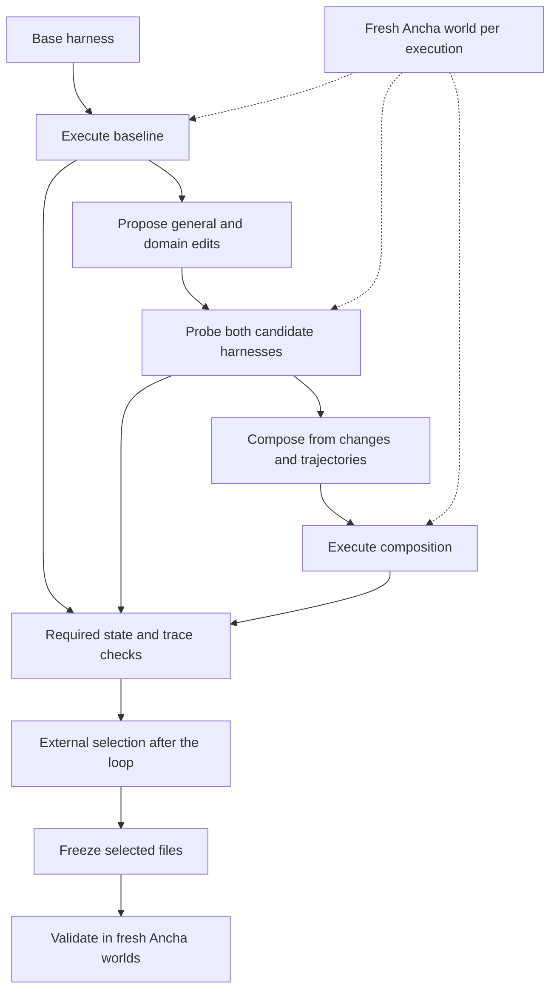

# Harness² on local incident-response worlds

An independent study of Harness²'s Propose–Probe–Compose workflow on an on-call task backed by Ancha's local Slack, GitHub, Datadog and PagerDuty twins. Two editor configurations used the same Haiku 5.5 executor and baseline evidence. The Opus-selected harness added an explicit Slack polling rule and passed all required checks in 2 of 3 fresh status-request runs; baseline and Sonnet-selected passed 0 of 3. This repository contains the adapter, scenario, executed harnesses and compact evidence from the study.

## Results

Development task: required state/trace checks passed per execution. Both episodes used the same 7/8 baseline.

| Editor | General probe | Domain probe | Composed run |
|---|---:|---:|---:|
| Sonnet 4.6 | 7/8 | 7/8 | 7/8 |
| Opus 4.8 | 8/8 | 3/8 | 8/8 |

Frozen validation: attempts passing **every** required check. Each run started a fresh world. Baseline and Sonnet trials were interleaved; the later Opus validation reused those baseline controls.

| Harness | status-request | bad-deploy | false-alarm |
|---|---:|---:|---:|
| Baseline | 0/3 | 1/1 | 1/1 |
| Sonnet-selected | 0/3 | 1/1 | 1/1 |
| Opus-selected | 2/3 | 1/1 | 1/1 |

The Opus harness answered the request in all three validation runs. One omitted the metric query and failed the investigation check. On bad-deploy, the Opus run took 161 seconds and baseline took 83 seconds, one attempt each. Across development and validation there were **22 distinct model-driven worlds**, plus two null/oracle controls, with no invalid trials. The shared baseline is counted once. [Detailed results](results/summary.md), [JSON](results/results.json), [per-run scores](results/README.md) and [selection evidence](results/selection/README.md) retain failures and timings.

## The Opus edit

This excerpt from [the complete diff](harnesses/opus-selected.diff) adds the trigger for a new `status-request` skill. The skill polls Slack after waits, after deployment and before finishing, and replies using the human message's `ts` as `thread_ts`.

```diff
--- base/systemprompt.md
+++ opus-selected/systemprompt.md
@@ -9,4 +9,9 @@
 5. Keep the team informed in the incident channel.
 6. Make sure the fix worked before you finish, then call finish.
 
+A human will post a status request as a NEW message in the incident channel while
+the incident is in progress; it is not there at the start, so re-read the channel as
+you go and do not finish until you have checked for it. When a human asks for status
+during an incident, or before you finish an incident, load the `status-request` skill.
+
 Alerts, logs and messages carry the incident's own timestamps. Use them, not your own clock, when you pick time ranges.
```

The [base](harnesses/base), [Sonnet-selected](harnesses/sonnet-selected) and [Opus-selected](harnesses/opus-selected) trees preserve all eight component categories, including unused and empty components. The [Sonnet diff](harnesses/sonnet-selected.diff) records the other selected edit.

## How it works



Harness² editors see the task, trajectories and agent responses. Scores stay outside their context. After the executions finish, external selection maximizes the fraction of required Ancha checks passed; ties prefer composition, then baseline. This extends the paper's selection protocol. See [methodology](docs/methodology.md), [adapter](adapter/README.md), [bridge](bridge/README.md) and [scenario](scenario/README.md).

## Reproduce

Requirements: macOS or another POSIX environment, Python 3.12 or 3.13, Node 24 or later, npm, Git, and an OpenRouter account with the models below available. The recorded runtime was Python 3.12.8, Node 24.22.2 and OpenCode 1.14.18. Remote model sampling and elapsed time can change outcomes.

Run from the repository root:

```sh
python3.12 -m venv .venv
. .venv/bin/activate
python -m pip install -r adapter/requirements.txt
npm i -g @ancha-labs/cli
npm i -g opencode-ai@1.14.18
npm ci --prefix scenario
```

The recorded runs used **Ancha CLI 0.1.4 plus the experimental stdio bridge in this repository**. Ancha 0.1.5 ships native MCP endpoints for the same four twins, configured with `ancha mcp config`; those endpoints were not used in these runs. To match the recorded CLI, install its exact version after the general installation above:

```sh
npm i -g @ancha-labs/cli@0.1.4
ancha --version
opencode --version
```

The copied scenario package also contains a historical CLI 0.1.1 devDependency. These commands invoke the global 0.1.4 executable directly. SDK dependencies come from the scenario lockfile.

Set `OPENROUTER_API_KEY` in the environment through your shell or secret manager. Pass no key values on the command line. The isolated launcher keeps Ancha's parent process key-free so optional judges remain skipped, and gives the executor the key through a private runtime file. That file and generated output live under ignored `.work/`. See [configuration and cleanup](adapter/README.md#configuration).

The following commands run the controls and the Sonnet episode, then validate its frozen selection. The null command exits 1 because it fails required checks.

```sh
python adapter/lab_env.py ancha --local run scenario/scenes/incidents/status-request/scene.yaml --agent 'node scenario/scenes/incidents/status-request/null.mjs' -n 1 --parallel 1 --out .work/receipts/null --json
python adapter/lab_env.py ancha --local run scenario/scenes/incidents/status-request/scene.yaml --agent 'node scenario/scenes/incidents/status-request/oracle.mjs' -n 1 --parallel 1 --out .work/receipts/oracle --json
python adapter/lab_env.py --paid python adapter/cost.py initial
python adapter/lab_env.py --paid python adapter/adapter.py baseline --name oncall-k1
python adapter/lab_env.py --paid python adapter/adapter.py optimize --name oncall-k1
python adapter/lab_env.py --paid python adapter/compare.py --source oncall-k1 --name validation
```

The Opus episode reuses the original baseline trajectory and response, as the study did. It does not rerun that baseline or receive Sonnet candidates. Run it after the first validation finishes:

```sh
mkdir -p .work/receipts/oncall-opus/executions
cp -R .work/receipts/oncall-k1/executions/baseline-status-request .work/receipts/oncall-opus/executions/
python adapter/lab_env.py --paid H2_EDITOR_MODEL=openrouter/anthropic/claude-opus-4.8 python adapter/adapter.py optimize --name oncall-opus
python adapter/lab_env.py --paid python adapter/compare.py --source oncall-opus --name validation-opus --selected-only
python adapter/lab_env.py --paid python adapter/cost.py final-settled
```

Wait for the OpenRouter meter to settle before treating the last reading as final. Each optimization uses `k=1`, two proposal sessions, one composer session and three new candidate executions. [Validation plans](results/selection/README.md) retain the predeclared seeds, order and frozen hashes. To test the published Opus tree directly:

```sh
python adapter/lab_env.py --paid python adapter/adapter.py validate --name published-opus --harness harnesses/opus-selected --repeats 1
```

The `validate` action runs all three study tasks; `--task` applies to `baseline` and `optimize`. The complete frozen-validation schedule is implemented by `compare.py` above. To check the upstream deterministic workflow without model calls:

```sh
python adapter/lab_env.py harness2-demo --output .work/receipts/demo --k 2
```

## Cost

Total metered OpenRouter usage was **$3.169185647**, rounded to **$3.17**, including setup attempts, smoke runs, both editor episodes, validation and incidental title calls. The Sonnet workflow took 19.87 minutes including baseline; the Opus follow-up took 15.68 minutes with baseline reused. These times exclude setup and validation.

Observed prices at experiment setup, USD per million tokens:

| Model | Role | Input | Output |
|---|---|---:|---:|
| `anthropic/claude-haiku-5.5` | Executor | $0.10 | $0.50 |
| `anthropic/claude-sonnet-4.6` | First editor/composer | $3 | $15 |
| `anthropic/claude-opus-4.8` | Second editor/composer | $5 | $25 |
| `anthropic/claude-haiku-4.5` | OpenCode session titles | $1 | $5 |

These are historical prices, with cache rates and context tiers in [the price receipt](cost/model-prices.md). [Cost boundaries](cost/cost.md) and [workflow timing](cost/workflow-time.json) describe the accounting. Intermediate meter readings can lag; step-level estimates omit title calls.

## Scope

This is a small incident-response integration study. It runs the real Harness² core on a prompt-and-skill editing surface with a fixed executor. It does not reproduce WorkBuddy-Bench, JobBench or LAB scores. Required checks cover authored operational outcomes; optional language-model quality judges were skipped. The tool permissions and loopback bridge restrict exposed operations, while network contamination and a hardened OS boundary remain outside the experiment. One episode per editor and three repeated incidents do not establish a model ranking or a general success-rate estimate.

## Reference

[*Harness²: Recursive Agent Harnessing for an Open World*](https://arxiv.org/abs/2610.14224), arXiv:2610.14224. [Google Research repository](https://github.com/google-research/harness2). This study uses commit `6868817518876de8fd170c6a8354daca273b6191`; [requirements](adapter/requirements.txt) pin that revision. The paper title and identifier were checked against the arXiv record.

## License and author

[Apache License 2.0](LICENSE). Copyright 2026 Patrick Liu.

Patrick Liu, Ancha.

Harness² is a Google Research repository, not an officially supported Google product. This is an independent study; it implies no endorsement of, or partnership with, Ancha.
